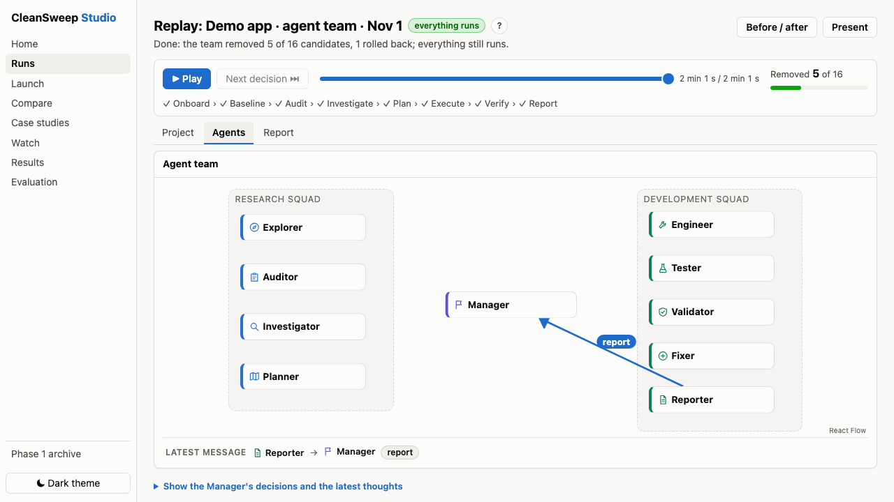
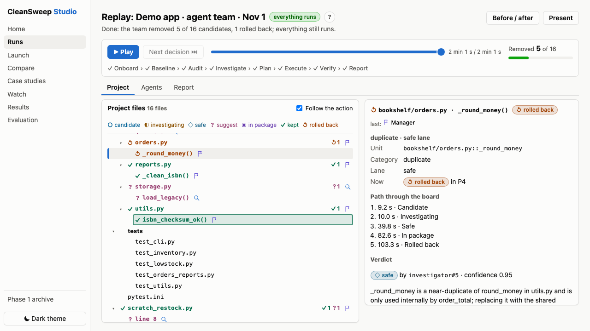
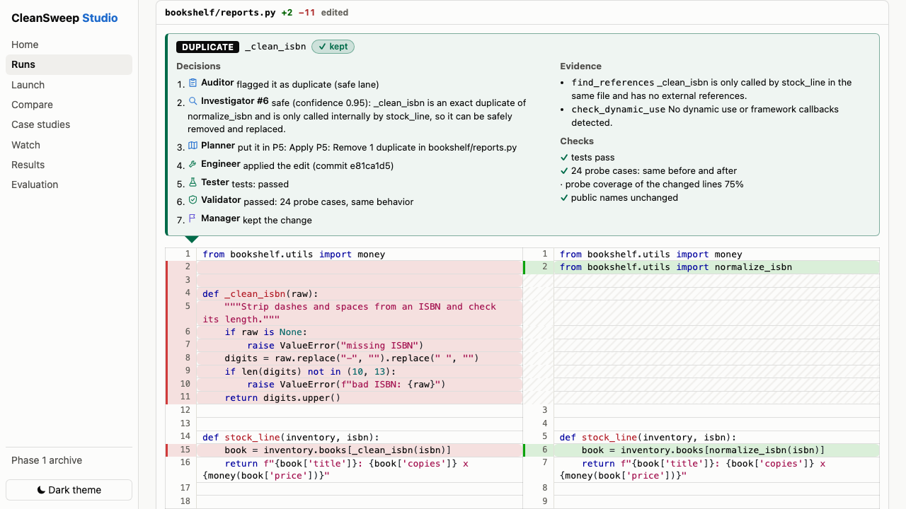
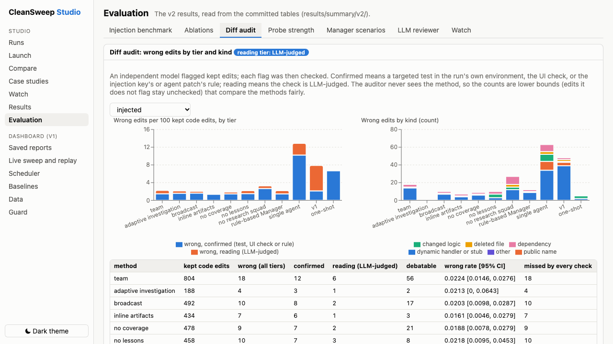

# A guided tour

This page walks through CleanSweep the way you would explain it to someone new: the problem,
the three phases, the agents, the Guard, how we measure, and where every number comes from.
The deep references are [agentic_design.md](../agentic_design.md),
[architecture.md](../architecture.md) and [experiments.md](../experiments.md).

## The problem in one example

An agent leaves this behind in a project:

```python
class NameCollector(ast.NodeVisitor):
    def visit_Name(self, node):      # nothing in the project calls this
        self.names.append(node.id)
```

A dead-code detector sees a method with no caller and wants to delete it. But `ast.NodeVisitor`
calls `visit_Name` by name, so deleting it changes what the program does, and often no test
notices. The same goes for a helper that looks like a duplicate but rounds 0.125 to 0.13 where
the "same" helper rounds it to 0.12. Cleaning up is easy; cleaning up without changing behavior
is the hard part. That is what CleanSweep is about.

## Three phases

| Phase | Name in the code | Dates | What it is | Releases |
|---|---|---|---|---|
| Phase 1 | v1, `method=cleansweep` | Oct 19 – Oct 30 | the pipeline: detect, judge, batch, Guard | v1.0 (Oct 30), v1.0.1–v1.0.3 |
| Phase 2 | v2, `cleansweep clean`, `method=agentic` | Oct 31 – Nov 6 | the agent team, Studio (the web UI) and the evaluation tools | v2.0 (Nov 5), v2.1 (Nov 6), v2.1.1–v2.1.2 (the fixes the Phase 3 runs used) |
| Phase 3 | v3 | Nov 6 – Nov 14 | the pre-registered final evaluation and the final release | v3.0 (Nov 14) |

The repository uses the internal names in folder and method names (`results/summary/v2/`,
`scripts/experiments/v3/`), so you will see both. In the report and the talk we say Phase 1,
2 and 3.

## Phase 1: the pipeline

```
project -> open a copy -> analyze -> plan (Reviewer) -> rank -> batch (Scheduler)
                                                                       |
report <- hidden checks (evaluation only) <- Guard: apply, verify, keep or roll back
```

- **Reviewer.** Detectors find leftover files, dead code, unused imports and dependencies,
  duplicates, wrappers, formatting and security problems. An LLM judge reads each finding with
  its evidence. Every item lands in a lane: **safe** (the Guard may apply it) or **suggest**
  (only reported). In the default gatekeeper mode, a judge "keep" or "suggest" moves an item to
  the suggest lane.
- **Policies** after the judge keep risky deletions in the suggest lane: public names in package
  modules (`keep_public_api`), and methods a framework calls by name (`framework_callbacks`:
  Textual, Django, Flask, FastAPI, Click, pytest, `http.server`, `ast.NodeVisitor`, PyTorch,
  Lightning, hatchling).
- **Scheduler.** Groups safe items into batches by risk, and decides when to sweep a project's
  history (after every agent pull request, daily, or never).
- **Guard.** See [below](#the-guard-and-the-probes).

## Phase 2: the agent team

`cleansweep clean <project>` cleans a whole project the way a careful engineer would. Its design
adapts AutoData (a multi-agent system for web data collection, NeurIPS 2025): a Manager and two
squads that talk through a message board.

The Manager walks through eight steps:

| Step | What happens |
|---|---|
| ONBOARD | the Explorer reads the project: packages, frameworks, entry points, how to install and test; a secret scan |
| BASELINE | the Tester installs the project and runs its tests 3 times, so flaky tests are known |
| AUDIT | the Auditor runs the detectors and the knowledge base: the candidates |
| INVESTIGATE | up to 3 Investigators, one ReAct loop per candidate: safe, suggest or drop, with evidence |
| PLAN | the Planner groups safe verdicts into work packages of up to 4 edits, and writes `blueprint.md` |
| EXECUTE + VERIFY | one package at a time: the Engineer applies it, the Tester and Validator check it, the Fixer repairs or rolls it back |
| FINAL VERIFY | the full suite against the baseline; if it is worse, packages are undone until it is not |
| REPORT | the Reporter writes `CLEANUP_REPORT.md`, a PR description and a git branch with one commit per package |

The ten agents:

| Agent | Squad | Job |
|---|---|---|
| Manager | (none) | runs the steps, assigns work, enforces budgets; at step boundaries the LLM may pick another allowed option (go back, replan, stop), and hard rules win |
| Explorer | research | the project brief |
| Auditor | research | candidates, from the detectors, the line-level detectors and the mined knowledge base |
| Investigator | research | a verdict per candidate; every evidence step cites a tool result |
| Planner | research | work packages, ordered by risk and dependencies |
| Engineer | development | applies a package, deterministic edits first |
| Tester | development | the baseline, the related tests, the full suite |
| Validator | development | coverage-guided probes, the UI check, the dependency and public-API checks |
| Fixer | development | repairs a failed package in at most 2 turns or rolls it back, and writes a lesson |
| Reporter | development | the report and the branch; every number comes from the records, not from the LLM |

Three ideas hold the team together:

- **Message board.** Each message has one sender and a named set of recipients; an agent reads
  only its own inbox.
- **Artifact cache.** Large things (the brief, the test baseline) are stored once and referenced
  by an ID.
- **Lessons.** Every rollback writes a lesson ("probes failed after merging `_round_money`"),
  and later decisions must check the lessons and cite the ones that apply.

The original project is never touched: `clean` works on a copy and hands over a branch you apply
yourself. Secrets never reach the LLM: the copy is scanned, secret files are withheld, and every
request goes through one redaction wrapper.



The Project tab (the default) of the same replay shows each file, class and function in its state. Here a
rolled-back duplicate's evidence is open:



## The Guard and the probes

The Guard applies a batch (Phase 1) or a work package (Phase 2) and keeps it only if nothing
changed:

| Check | Fails when |
|---|---|
| compile | a changed file no longer compiles or imports |
| tests | a test that passed at the baseline now fails |
| dependency | a removed package is still needed: the tests rerun with it uninstalled |
| AST | a formatting-only change changes the syntax tree |
| probes | the same calls give different results before and after the edit |
| UI check (Phase 2) | a Textual screen or widget renders differently |

**Differential probes.** The LLM writes small calls for the functions an edit touched, with
edge cases such as `.5` ties, zero, negative numbers, empty values and `None`. Our harness runs
them on the code before the edit (twice, to drop unstable cases) and after it, and compares.
A removed duplicate is also run against the function that replaces it. In Phase 2 the probes are
coverage-guided: up to 3 rounds, until the changed lines are covered. This is how the demo's
`_round_money` is caught: its tests pass either way, but the probe `0.125` gives `0.13` before
and `0.12` after.

**Rollback and bisection.** A failing batch is split in half until the bad edit is found, so
one bad edit among n costs about log n extra checks, and the good edits are kept.

**What the Guard cannot see.** Deleting a function nothing in the project calls leaves nothing
to run. That is why the policies above keep public names and framework callbacks in the suggest
lane, and why Phase 3 added the dynamic-reference resolver: entry points, names in config
files, decorator registries, `__all__`, `getattr` with a literal name and similar uses send a
unit to the suggest lane with the evidence.



## How we measure

### Hidden tests

A hidden test is one the cleaner never sees. We run it before and after the cleanup; if its
result changes, the cleanup changed behavior. Where they come from:

| Target set | Hidden tests |
|---|---|
| Toy repository and demo app | hand-written answer keys and hidden tests |
| SWE-bench | the task's own FAIL_TO_PASS and PASS_TO_PASS tests, and PatchDiff's tests |
| AIDev repositories | tests written by a second model (`glm-5-3`) for public functions |
| SlopBench (injected) | a test kept outside the project that checks the planted code |
| Phase 3 REAL projects | half of the project's own test modules, held out by seed |

### SlopBench, the slop-injection benchmark

We plant known slop into real projects at a fixed seed: a leftover file, a dead function, an
exact duplicate, an unused import, a debug print, a commented-out block and an unused
dependency. We also plant two **traps** a cleanup must keep: a near-duplicate that rounds
differently, and an `ast.NodeVisitor.visit_Name` reached only by name. Every plant is checked
before a run, and the hidden test must pass before any cleanup. Scores: the share of planted
slop removed (recall), the traps removed, and whether the hidden test changed. The data card is
[slopbench.md](../slopbench.md).

### The blinded diff audit, and its two tiers

Hidden tests check only what they test. To find wrong edits no test catches, an independent
model (`glm-5-3`, never the agents' model) reads every kept code edit of every method, without
being told which method made it, and votes 3 times: could this change behavior? Every edit it
flags is checked against a written rubric:

- **wrong:** changes behavior something in the project or its users can trigger;
- **debatable:** the code is reachable only from outside the project;
- **fine:** no observable change.

Each verdict has a **tier**:

- **confirmed:** a targeted test that passes before the edit and fails after it, run in the
  run's own environment; or the UI check; or a rule (the injection key);
- **reading:** decided by reading the code, so it is **LLM-judged** (read by the coding
  assistant that ran the evaluation). Each wrong reading records why no test could run.

Two cautions we always state. Only flagged edits are checked, so the wrong counts are lower
bounds; Phase 3 estimates how many the auditor misses by testing a random sample of "no"-voted
edits. And the reading tier rests on LLM judgment: Phase 3 checks it with a blinded panel of
three LLM judges from other model families (`gpt-oss-120b`, `llama4-maverick-17b` and
`gemma4-31b-it`), measured against the verdicts confirmed by a test or a rule (pre-registration
Deviation 9). The judges agree with each other moderately (Fleiss' κ = 0.382) and with the
recorded labels at κ = 0.455 (wrong vs not wrong), and are right on 11 of 18 confirmed verdicts:
they lean toward "wrong" ([judge_panel.md](../../results/summary/v3/judge_panel.md)).



### Phase 3: the pre-registered evaluation

The hypotheses H1 to H4, the run sizes, one 120-minute cap and 400-request budget for every
method, and the rules for timed-out runs were committed on Nov 6, before any main run
([preregistration_v3.md](../preregistration_v3.md)). Later changes are dated deviations.

| Set | What |
|---|---|
| INJECT | SlopBench seed 4 on 10 new repositories (out of sample) |
| REAL | 15 new repositories with half their tests held out; two runs each |
| AUTONOMY | 30 varied repositories: does `clean` finish on its own? |
| Second model | the team and the single agent with `deepseek-v4-1-flash` on 5 + 5 repositories |
| Aider | an external coding agent with the same model and a fixed cleanup instruction |

The methods compared: the team, the team without its research squad, a single agent with every
tool, the team with batching, the team without the resolver, Aider and the Phase 1 pipeline.
[status.md](status.md) has the scorecard for H1 to H4 in plain words, and the limits.

## Where each table and figure comes from

Every number in the report comes from a committed file. The aggregate tables rebuild offline
with `bash scripts/reproduce_tables.sh`; the per-run files need raw runs, Docker or the LLM.

| Folder | What | Written by |
|---|---|---|
| `results/data_summary/` | the AIDev funnel, the mined taxonomy and rules, the SWE-bench and tier counts, the Phase 3 repository pool | `scripts/data/*.py` |
| `results/summary/v1/` | Phase 1: main table, paired tests, Guard strength, AIDev, Scheduler, ranker | per-run CSVs by `scripts/experiments/v1/exp_*.py`; the aggregates by `exp_tables.py` and `exp_scheduler_tradeoff.py` |
| `results/figures/v1/` | Phase 1 figures | `exp_tables.py`, `exp_scheduler_tradeoff.py` |
| `results/summary/v2/` | Phase 2: the team against Phase 1, SlopBench, ablations, the real-project ablation, the diff audit, probe strength | per-run CSVs by `exp_collect_v2.py`, `exp_inject.py table`, `exp_real_ablation.py collect`, `exp_diff_audit.py`; the aggregates by `exp_tables_v2.py` and `exp_real_ablation.py table` |
| `results/summary/v3/` | Phase 3: H1 to H4, the audit, the audit-miss estimate, SlopBench's repository list | `exp_tables_v3.py` (at the freeze), `exp_audit_miss.py`, `slopbench.py list` |
| `results/figures/v3/` | Phase 3 figures | `scripts/report/make_figures_v3.py` (at the freeze) |

The report's tables and figures are built from these files, and Studio's Results and Evaluation
screens read the same files. The full list, file by file, is in
[experiments.md](../experiments.md#regenerating-the-tables).

## Studio, screen by screen

| Screen | Screenshot |
|---|---|
| Home: clean a folder, "Take the tour", "Try the demo" | [home.png](../images/studio/home.png) |
| Runs: every recording | [runs.png](../images/studio/runs.png) |
| Launch: start a cleanup, a sweep or a watch | [launch.png](../images/studio/launch.png) |
| Replay: the Agents tab (the team, the steps, the decisions) | [replay.png](../images/studio/replay.png) |
| Replay: the Project tab (the default) | [project.png](../images/studio/project.png) |
| A Manager step-back | [step_back.png](../images/studio/step_back.png) |
| Before / after | [before_after.png](../images/studio/before_after.png), [before_after_diff.png](../images/studio/before_after_diff.png) |
| Present (presentation mode) | [present.png](../images/studio/present.png), [present_after.png](../images/studio/present_after.png) |
| Compare | [compare.png](../images/studio/compare.png) |
| Case studies | [case_study.png](../images/studio/case_study.png) |
| Watch | [watch.png](../images/studio/watch.png) |
| Results and Evaluation | [results.png](../images/studio/results.png), [evaluation.png](../images/studio/evaluation.png) |
| Saved reports (Phase 1) | [saved_report.png](../images/studio/saved_report.png) |

The [user guide](../user_guide.md#studio) describes each screen. To see the demo: Home, then
"Try the demo".

## Glossary

| Term | Meaning |
|---|---|
| slop | code a coding agent left behind that the project does not need |
| hidden tests | tests the cleaner never sees, run before and after to detect a behavior change |
| held-out tests | Phase 3 REAL's hidden tests: half the project's own test modules, hidden by seed |
| visible break | a test the cleaner could see that stops passing |
| safe lane | items the Guard may apply |
| suggest lane | items that are only reported, for a person to decide |
| drop | an Investigator verdict: not slop after all, left out |
| trap | planted code that looks like slop but must stay (the near-duplicate, the framework callback) |
| answer key | the list of planted items and the expected outcome for each, for the toy repository and the demo app |
| work package | up to 4 edits in one file of one risk level, applied and checked together |
| probe | a small call to a changed function, run before and after the edit |
| rollback | undoing a package or batch that failed a check |
| bisection | splitting a failed batch in half until the bad edit is found |
| lesson | a note written after a rollback that later decisions must check |
| research squad | the Explorer, Auditor, Investigator and Planner; "no research squad" is the ablation without the Investigators |
| single agent | one LLM with every tool, keeping or reverting its own edits (an ablation) |
| everything runs | the result when the final tests are at least as good as the baseline |
| nothing applied | the result when no edit was kept |
| confirmed | an audit verdict backed by a targeted test, the UI check or a rule |
| reading | an audit verdict from reading the code; LLM-judged |
| LLM-judged | decided by a language model, not by a test or a person |
| timed out | a run that hit the 120-minute cap or the 400-request budget; it stays in every denominator |
| yield | how much slop a method removes |
| pre-registration | the hypotheses and rules fixed before the runs |
| deviation | a dated, explained change to the pre-registration |
| freeze | Nov 13, 12:00 Arizona time: results are final after this |
