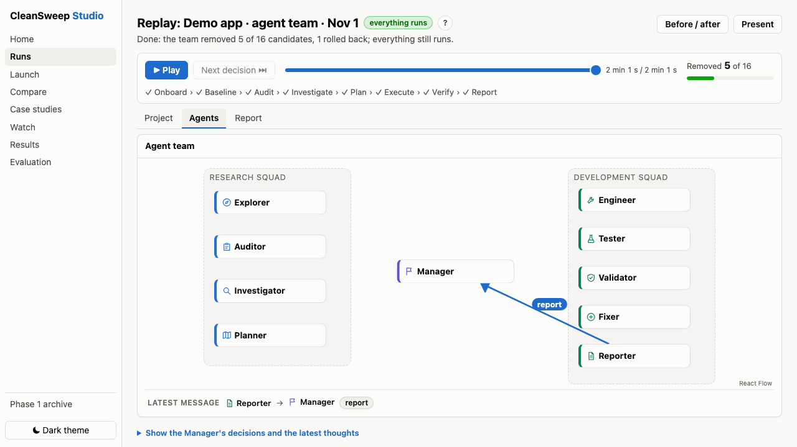
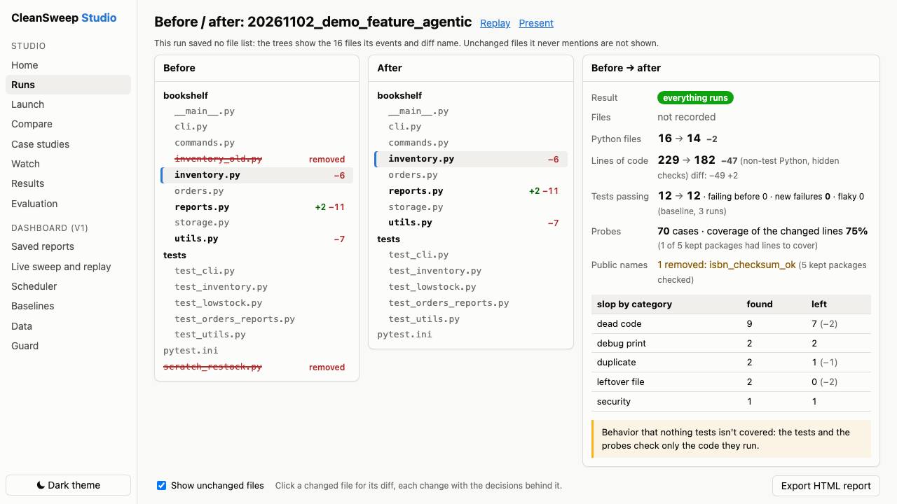
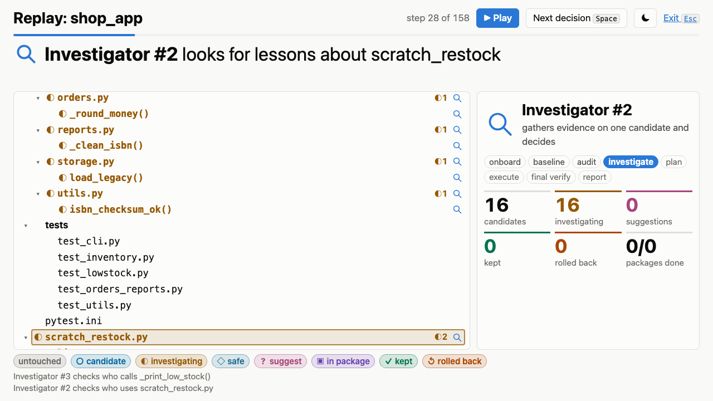
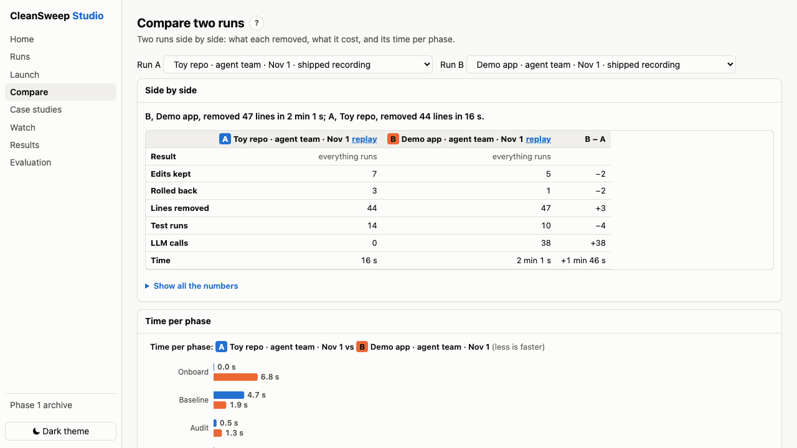
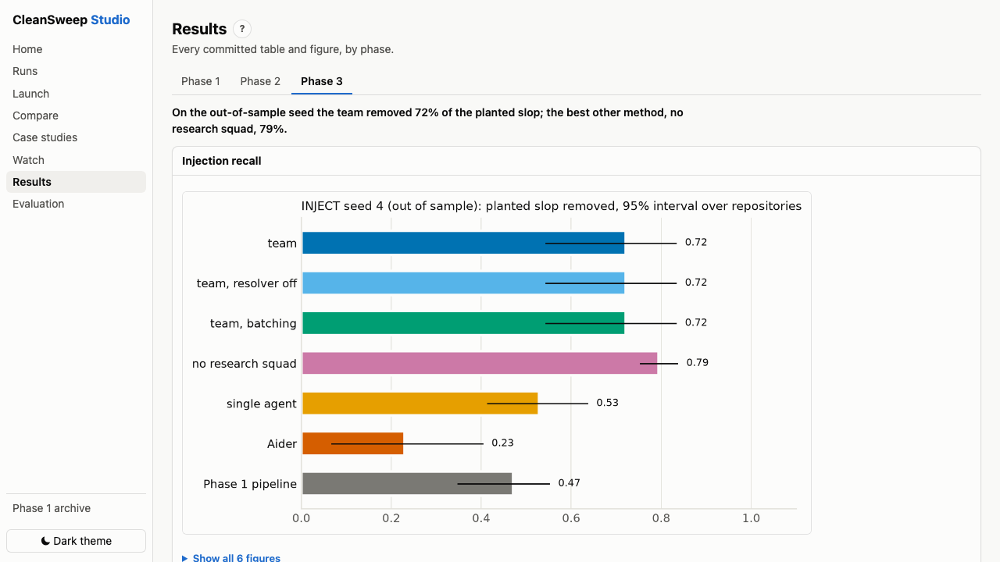
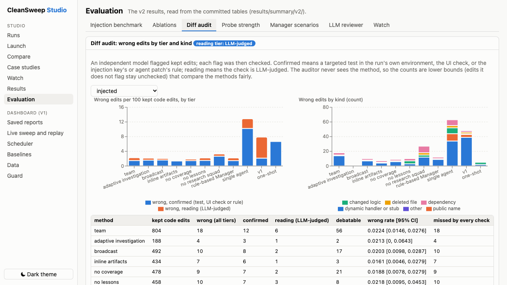

# User guide

CleanSweep removes the code a coding agent left behind in a Python project (scratch scripts,
old copies, dead functions, duplicate helpers, unused imports and dependencies) and keeps an
edit only if the project still behaves the same. This guide covers installing it, cleaning a
project, reading and applying the result, per-project settings, watch mode, and Studio, the web
UI. How it works inside is in [agentic_design.md](agentic_design.md) (the v2 agent team) and
[architecture.md](architecture.md) (the v1 sweep).

## Install

```bash
python3.11 -m venv .venv && source .venv/bin/activate
pip install -r requirements.txt && pip install -e .
cleansweep --help
```

For the LLM features, put an OpenAI-compatible endpoint in `.env` (`VOYAGER_API_KEY`,
`VOYAGER_BASE_URL`, `VOYAGER_MODEL`); see the [README](../README.md#quick-start). Never commit
`.env`. Without a key, `--no-llm` runs everything offline: the agents decide by rules.

## Clean a project

```bash
cleansweep clean path/to/project --dry-run          # plan only: writes blueprint.md
cleansweep clean path/to/project                    # safe mode
cleansweep clean path/to/project --mode thorough    # also LLM rewrites of near-duplicates
cleansweep clean tests/fixtures/toy_repo --no-llm   # a first try, offline, on the toy repo
```

The original folder is never changed. `clean` copies the project into a scratch workspace next
to it (`<project>-cleanup-<time>/`, or `--out`) and the agent team works in phases: ONBOARD
(what the project is and how its tests run), BASELINE (the tests three times, so flaky tests
are known), AUDIT (the detectors list candidates), INVESTIGATE (each candidate gets a verdict:
safe, suggest or drop, with evidence), PLAN (work packages of up to four edits), EXECUTE (one
package at a time: apply, run the related tests and the probes, keep it or roll it back),
FINAL VERIFY (the full suite against the baseline) and REPORT. The terminal shows each phase
and each package as it ends:

```
-> EXECUTE: 10 work packages to apply
   P1 kept
   ...
-> FINAL_VERIFY: every work package is done
-> REPORT: the final suite is at least as good as the baseline

Result: everything runs. 7 edits applied; 44 lines and 3 files removed; 10 suggestions.
```

**Safe mode** (the default) applies only deterministic edits (deleting a file, a function or
an import, replacing an exact duplicate by the original), each one verified; anything uncertain
is a suggestion in the report. **Thorough mode** also lets the LLM rewrite a near-duplicate to
use the original, with more probe rounds, and lets the Fixer repair a behavior change the probes
find. `--budget llm=150,minutes=60,tests=80` caps the whole run; a run that hits a cap delivers
the packages it finished.

`clean` runs the project's tests on your machine (in a virtual environment in the output folder
when the project can be installed, else with CleanSweep's interpreter). Clean only code you
trust, or run CleanSweep inside a container when you don't.

### The result

| In the output folder | What it is |
|---|---|
| `CLEANUP_REPORT.md` | the result, the tests before and after, every work package and its outcome, what was rolled back and why, the suggestions, the lessons, the cost |
| `blueprint.md` | the plan: every candidate with its verdict and evidence, and the work packages |
| `workspace/` | the cleaned copy, a git repository on branch `cleansweep/cleanup-<time>`, one commit per kept package |
| `patches/` | the same commits as patch files |
| `PR_DESCRIPTION.md`, `CHANGELOG_ENTRY.md` | text for a pull request and a changelog |
| `report.json`, `events.jsonl`, `cache/` | the run's numbers, its event log and the agents' artifacts (Studio replays them) |
| `project_files.json` | the project's files and their line counts before the cleanup (Studio's tree) |

The result is one of three. **Everything runs**: tests ran, and the final suite is at least as
good as the baseline. **Nothing applied**: a dry run, or no package survived its checks.
**Not verified**: something was applied, but the final check could not show that nothing got
worse (for example, the project's tests give no result); read the report before using it. The
exit code is 0 for the first two and 1 otherwise; 2 means a bad option or settings file.

### Apply the result

Read `CLEANUP_REPORT.md` first. For a git project the branch builds on the project's own
history (uncommitted changes, if any, are its first commit), so you can review and merge it:

```bash
cd path/to/project
git fetch ../project-cleanup-<time>/workspace cleansweep/cleanup-<time>
git log -p HEAD..FETCH_HEAD          # review each package
git merge --ff-only FETCH_HEAD       # or cherry-pick the packages you want
```

For a folder that is not a git repository, apply the patch files instead:
`git apply ../project-cleanup-<time>/patches/*.patch`. Deleted files are also kept in the output
folder's `quarantine/`.

### Options and the settings file

Options: `--mode safe|thorough`, `--budget llm=150,minutes=60,tests=80`, `--approve-plan` (show
`blueprint.md` and ask before applying), `--dry-run`, `--out DIR`, `--exclude FOLDER`
(repeatable), `--test-args "..."` (extra pytest arguments), `--no-install` (run the tests with
CleanSweep's interpreter), `--model`, `--no-llm`, `--config FILE`, `--quiet`. What each one does
in detail: [agentic_design.md, section 15](agentic_design.md#15-command-line).

A `.cleansweep.yaml` at the project's root (or `--config FILE`) holds the settings a project
always wants:

```yaml
mode: safe                                # or thorough
budget: {llm: 150, minutes: 60, tests: 80}
exclude: [tests/fixtures, docs/examples]  # folders the cleanup leaves alone
test_args: "-m 'not slow'"                # extra pytest arguments
install: auto                             # off: run the tests with CleanSweep's interpreter
model: my-model                           # default: VOYAGER_MODEL
```

The command line overrides the file (`--budget` per item; `--exclude` folders are added to the
file's), and `clean` prints which file it read. An unknown setting or a bad value stops the run
with one line naming the file and the setting.

## Watch a repository

```bash
cleansweep watch path/to/repo --once                        # one poll: measure, decide, maybe clean
cleansweep watch path/to/repo --interval 600 --budget-tests 200
```

Watch mode follows a git repository's commits. Each poll measures the slop at the newest commit
with the static detectors and decides: **clean** when the open slop is at least 2% of the
Python lines, when the commits since the last clean added at least 3 items, or after 20 commits
with slop open; otherwise **wait**, with the reason. A clean runs `clean` on a copy of that
commit (the repository is never written to) and is capped by the test runs left in
`--budget-tests`. Every poll is a line in `<repo>-watch/watch_log.jsonl` (or `--out`), and the
watch resumes from `watch_state.json`. Studio's Watch screen shows the log.

## Studio

```bash
cleansweep studio                      # http://127.0.0.1:8765; --port, --runs DIR, --no-browser
```

The first start builds the frontend with npm (node 20 or later); without npm it prints the
commands (`cd app/studio/frontend && npm ci && npm run build`). Studio listens on localhost only.
It reads three folders: its runs folder (`results/raw/studio/`, or `--runs`), `results/` and
`demo/replay/`. Hidden files, `.env` and other secret files are never served, and every text it
sends goes through the same redactor the agents use. Everything except Launch works offline;
`demo/replay/` ships four agent-team recordings beside v1's (the toy repo, the demo app with the
feature patch, a Manager step-back scenario and the Skill_Seekers case study; see the README).
The theme button switches between light and dark. [studio_design.md](studio_design.md) has the
rules every screen follows (type, spacing, the colors and glyphs of each item state, motion).

**Home** is where Studio opens. Paste a project's absolute path into "Clean a folder", choose
safe or thorough mode and the sandbox (auto, docker or none; docker needs a CleanSweep that has
the Docker sandbox), and Start: Studio runs `cleansweep clean` on a copy and opens the live run.
A path that can't be cleaned gets a one-line reason (no such folder, a file, no Python files).
"Try it on" fills in the toy repo or the demo app. Below are the most recent cleanups.


**Runs** lists every recorded run (agent-team cleanups, v1 sweeps, watch folders) with its
target, mode, model and result. Open one in Replay, follow a live one, or send it to Compare.


**Launch** cleans a project with the agent team (mode, model, budgets, offline, dry run), sweeps
it with a v1 method and judge mode, or watches a git repository (polls, interval, test budget).
Targets: the toy repo, the demo app, the prepared demo, or any absolute path. The runs started
in this session are listed with their status, output and a stop button.


**Live run** and **Replay** show a run as it happens or from its recording:
- the Project tab (the default): the project's file tree. Every file, class, function and line
  range a detector flagged has the color, glyph and name of its state (candidate,
  investigating, safe, suggest, in package, kept, rolled back) and the icon of the agent that
  acted on it last; the latest action is outlined, and "Follow the action" opens the tree to it.
  Click a node for its evidence chain (the verdict, the evidence, the Investigator's tool calls,
  the lessons it cited), its diff and the checks its work package passed. A run saves its file
  list (`project_files.json`), so the tree shows every file with its line count; for a recording
  made before v2.1 the tree shows the files the events name, and says so;
- the metrics bar: slop meter, packages done, test runs, probe cases, probe coverage, LLM calls
  and tokens, elapsed time, with gauges against the run's budgets;
- the phase timeline: time per phase, step-backs outlined, the Manager's decisions as marks;
- the agent graph: the Manager between the research and development squads, each message
  travelling from its sender to its recipients, each agent's steps, LLM calls and time;
- the message board (filterable, with links to the cached artifacts), the item board (each
  candidate's verdict, evidence and the investigator's tool calls), the work packages (diff,
  tests, the probe table before and after, coverage, the commit) and the report with the whole
  diff.

Replay adds play/pause, step, a 1–50x speed, a scrubber and "Next decision"; a click on a
decision jumps to it. A run folder from `cleansweep clean` replays as it is.




**Before / after** (from Runs, Home or a replay's header) shows a finished cleanup's result:
the project's tree before and after side by side (removed files struck through, edited files
with their +/− line counts, folders that disappeared marked), and a card with the numbers before
and after: files, Python files, lines of code (non-test Python), the tests passing (with the
baseline's failing and flaky tests and any new failures), the probe cases and the coverage of the
changed lines, the public names the cleanup removed, the slop found and left by category, and
the result. One line says what no check can: behavior that nothing tests isn't covered. Click a
changed file for its side-by-side diff; each change has a note pointing at it with its category,
the decisions behind it (Auditor, Investigator, Planner, Engineer, Tester, Validator, Manager),
the Investigator's evidence and the checks its package passed. A recording made before v2.1
saved no file list, so its trees show the files its events and diff name, and its file count is
"not recorded".




**Presentation mode** ("Present" in a replay's or a before / after header) is for a projector:
no sidebar, large type, and one plain caption per step ("Investigator #3 checks who calls
_print_low_stock()"). The tree follows the agent at work and a panel shows that agent and the
counts so far. Play advances at a fixed pace (1.5 s per step); the space bar (or a clicker's
Page Down) jumps to the next decision, Shift+space back, the arrow keys one step, P plays or
pauses, Escape leaves. On before / after it shows the summary, then one change per slide (5 s
each when playing): the category, the Investigator's reason, the decisions as a chain of agents,
the side-by-side diff and the checks.




In the step-back recording, FINAL VERIFY finds the full suite worse than the baseline, and the
Manager goes back to EXECUTE and undoes only the package that broke a test (outlined on the
timeline):


**Compare** puts two runs side by side (result, edits, lines and files removed, test runs, LLM
calls and tokens, time, packages, step-backs, verdicts, lessons) with their time per phase.



**Case studies** (`results/raw/case_studies/`) shows each real project's tests before and after,
its size, what happened to each candidate by category, the diff and its stats,
`CLEANUP_REPORT.md`, and the review sheet with the "LLM-reviewer acceptance (independent model,
blinded)" decisions, votes and reasons. These are an LLM's judgment, not a human review.


**Watch** shows a `cleansweep watch` folder: the commit stream with each decision and its
reason, open slop over time with the cleans marked, the test budget used and links to the clean
runs; below it, the simulated watch over recorded histories
(`results/summary/v2/watch_replay.csv`).


**Results** shows every table under `results/summary/v1` and `v2` (sortable, with its Markdown
notes) and every figure.



**Evaluation** charts the v2 results from the same committed tables, one tab each: the injection
benchmark (each seed and all seeds pooled, with 95% CIs, and the paired tests), the ablations
(with their LLM requests and minutes) and the real-project ablation, the diff audit (wrong edits
per method in two tiers, confirmed and reading, and by kind), probe strength, the Manager
scenarios, the LLM reviewer's acceptance and watch. Anything an LLM judged carries an
"LLM-judged" label. A table that is not built yet says so.



**Dashboard (v1)** has the old Streamlit dashboard's pages, with the same data. **Saved
reports** shows any sweep report saved under `results/`, the runs folder or `demo/replay/`: its
numbers, slop meter, plan, Guard verdicts with diffs and the command that restores a quarantined
file. **Live sweep and replay** lists the v1 runs (stages, the Reviewer's plan, Guard checks,
diffs, hidden checks, the answer-key score). **Scheduler**, **Baselines**, **Data** and
**Guard** show the v1 result tables and figures.


Studio's own checks run from `app/studio/frontend`: `npm run build`, `npx vitest run` and
`npx playwright test` (Chromium). The screenshots in this guide come from
`e2e/guide.spec.ts`, run against this repository's results (see the comment at its top).
Studio replaced the Streamlit dashboard in v2.0; git history keeps the dashboard.

## The v1 sweep

The v1 pipeline (`method=cleansweep`) is still there for the experiments and the demo:

```bash
cleansweep plan  --target path/to/project          # the plan, nothing applied, no LLM
cleansweep sweep --target path/to/project --out results/raw/quickstart/report.json --hidden
cleansweep show  results/raw/quickstart/report.json
```

[architecture.md](architecture.md) describes it, and Studio's Saved reports screen shows any
report it saves. The sweep's scratch workspace is removed when it ends; `--keep-workspace` keeps
it for a look inside.

## When something goes wrong

| Message | What to do |
|---|---|
| `no such folder` / `no Python files in ...` | point `clean` at the project's root folder |
| `--out must be outside the project folder` | pick an output folder outside the project; the original is never written to |
| `the output folder is not empty` | pick a new `--out`, or remove the old one |
| `--approve-plan needs a terminal` | run it in a terminal, or use `--dry-run` and read `blueprint.md` |
| `unknown budget item` / a settings-file error | the message names the item or the setting and the values it takes |
| result "not verified" | the report's Tests section says what the final check saw; often the project's tests give no result in this environment (try `--test-args` or `--no-install`) |
| LLM request timeouts in the log | they are retried; a run that keeps timing out ends with the budget it has, or use `--no-llm` |
