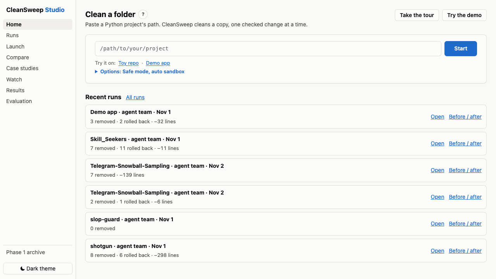
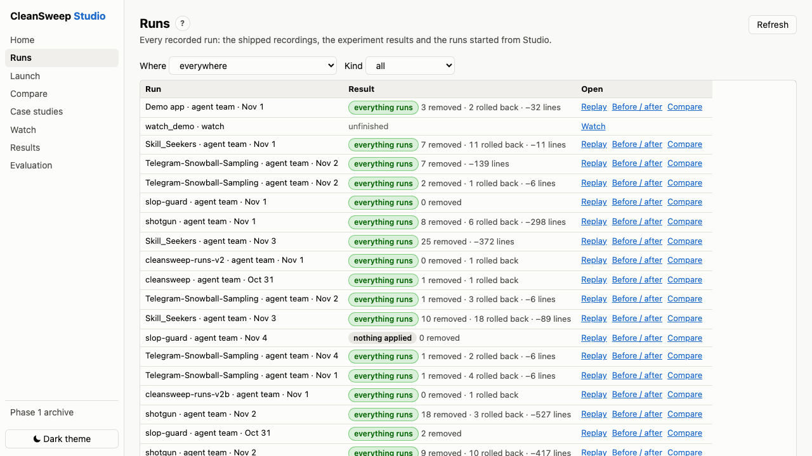
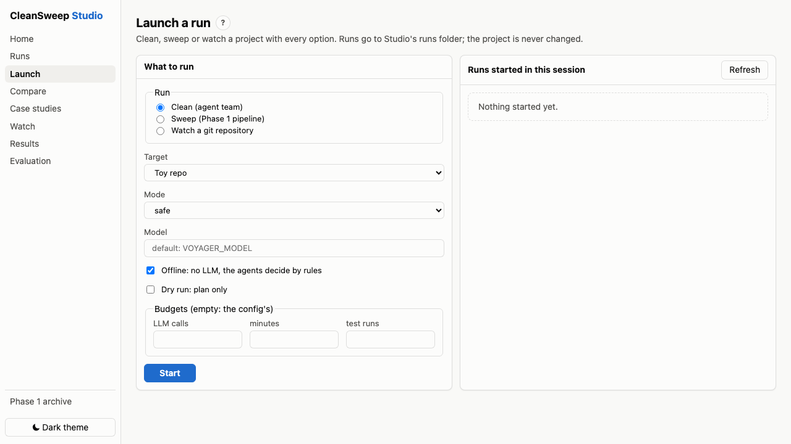
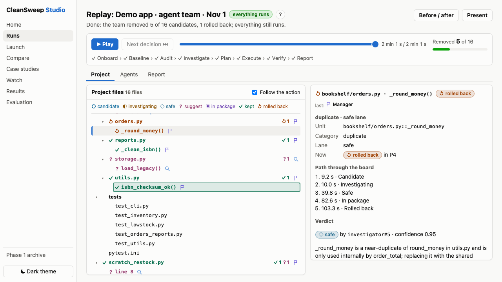
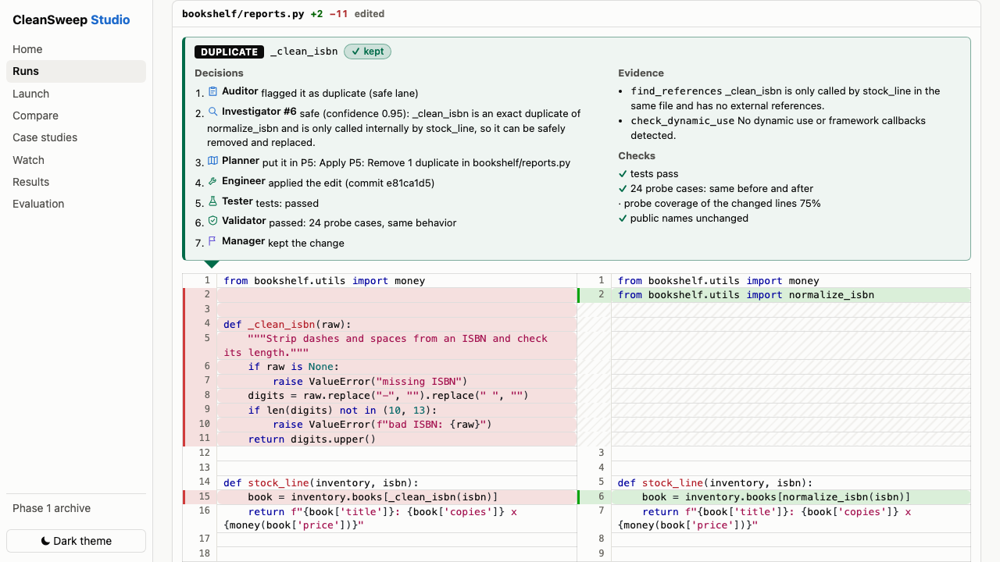
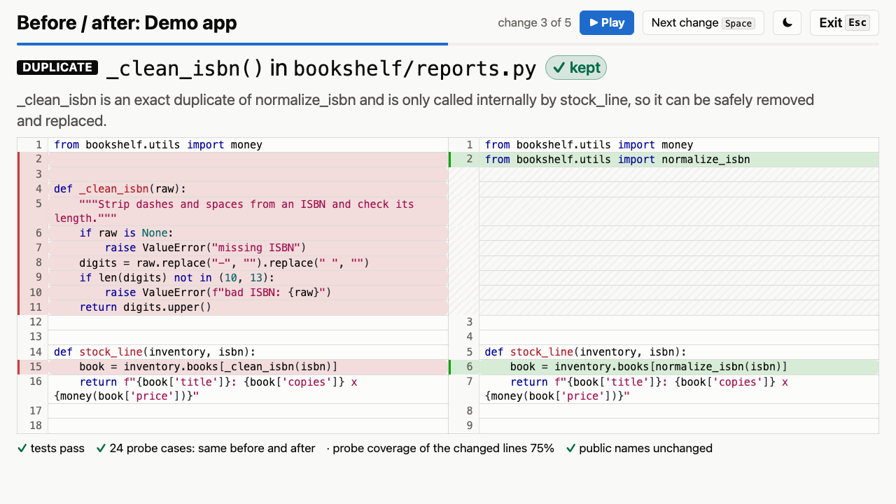
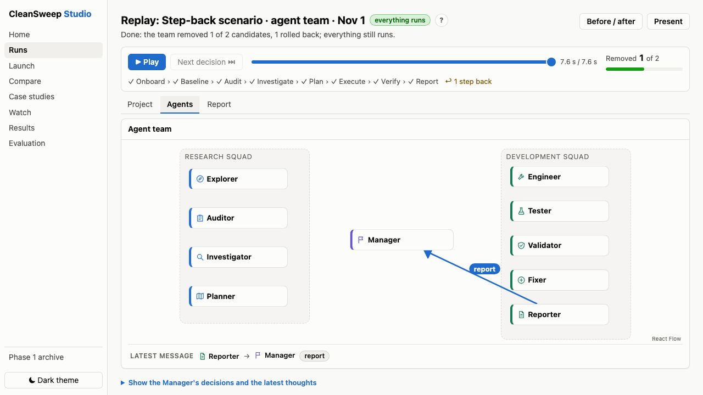
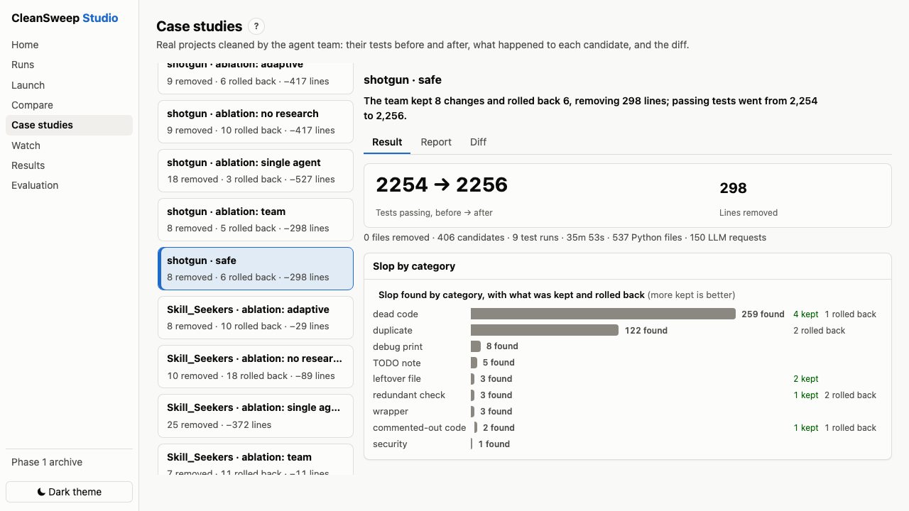
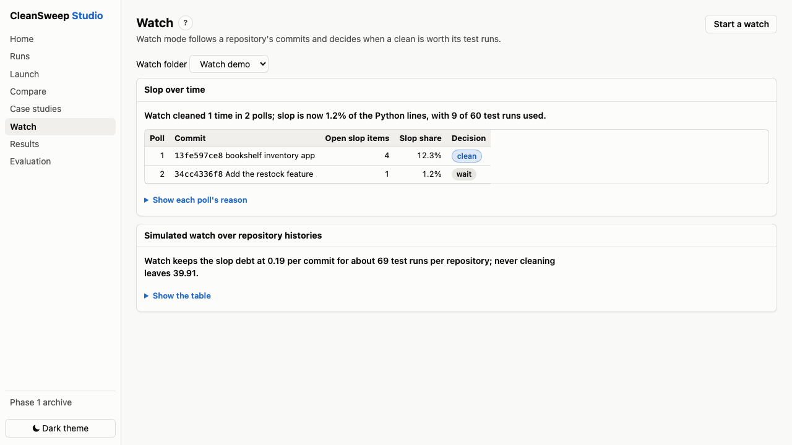
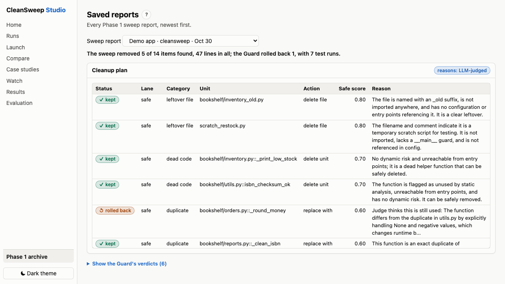

# User guide

CleanSweep removes the code a coding agent left behind in a Python project (scratch scripts,
old copies, dead functions, duplicate helpers, unused imports and dependencies) and keeps an
edit only if the project still behaves the same. This guide covers installing it, cleaning a
project, reading and applying the result, per-project settings, watch mode, and Studio, the web
UI. How it works inside is in [agentic_design.md](agentic_design.md) (the v2 agent team) and
[architecture.md](architecture.md) (the v1 sweep).

## Install

```bash
python3.11 -m venv .venv && source .venv/bin/activate
pip install -r requirements.txt && pip install -e .
cleansweep --help
```

For the LLM features, put an OpenAI-compatible endpoint in `.env` (`VOYAGER_API_KEY`,
`VOYAGER_BASE_URL`, `VOYAGER_MODEL`); see the [README](../README.md#quick-start). Never commit
`.env`. Without a key, `--no-llm` runs everything offline: the agents decide by rules.

## Clean a project

```bash
cleansweep clean path/to/project --dry-run          # plan only: writes blueprint.md
cleansweep clean path/to/project                    # safe mode
cleansweep clean path/to/project --mode thorough    # also LLM rewrites of near-duplicates
cleansweep clean tests/fixtures/toy_repo --no-llm   # a first try, offline, on the toy repo
```

The original folder is never changed. `clean` copies the project into a scratch workspace next
to it (`<project>-cleanup-<time>/`, or `--out`) and the agent team works in phases: ONBOARD
(what the project is and how its tests run), BASELINE (the tests three times, so flaky tests
are known), AUDIT (the detectors list candidates), INVESTIGATE (each candidate gets a verdict:
safe, suggest or drop, with evidence), PLAN (work packages of up to four edits), EXECUTE (one
package at a time: apply, run the related tests and the probes, keep it or roll it back),
FINAL VERIFY (the full suite against the baseline) and REPORT. The terminal shows each phase
and each package as it ends:

```
-> EXECUTE: 10 work packages to apply
   P1 kept
   ...
-> FINAL_VERIFY: every work package is done
-> REPORT: the final suite is at least as good as the baseline

Result: everything runs. 7 edits applied; 44 lines and 3 files removed; 10 suggestions.
```

**Safe mode** (the default) applies only deterministic edits (deleting a file, a function or
an import, replacing an exact duplicate by the original), each one verified; anything uncertain
is a suggestion in the report. **Thorough mode** also lets the LLM rewrite a near-duplicate to
use the original, with more probe rounds, and lets the Fixer repair a behavior change the probes
find. `--budget llm=150,minutes=60,tests=80` caps the whole run; a run that hits a cap delivers
the packages it finished.

`clean` finds how the project runs its tests from its own files: pytest settings, a
`conftest.py`, tox or nox (the pytest or unittest command they run), a Makefile `test` target, or
test files that are all `unittest.TestCase` (`python -m unittest discover`); the report says
which it chose and why. It installs the project into a virtual environment in the output folder
from `pyproject.toml` (with its test/dev extras and dependency groups), `setup.py`/`setup.cfg`
or `requirements*.txt`, with poetry or uv when the project has their lock file and the tool is
installed (pip otherwise), and puts a `src/` layout on the import path. If the install fails,
the tests run with CleanSweep's interpreter and the report says so.

A project with no tests, or whose tests cannot run, is still cleaned, more carefully: only the
edits the probes cover are applied (an import or a private function the module check covers, a
change whose lines the probes ran); file and dependency removals and public functions stay
suggestions, and the result says "not verified by tests". No test runs a notebook either, so
whatever a notebook's code uses (a function, a file, a dependency) stays a suggestion.

**Where the project's code runs.** Installing a project and running its tests runs its code.
`--sandbox docker` runs all of it (the install, the tests, the probes) in a `python:3.11`
container: the workspace copy is mounted there, the project is installed with the network on,
and the network is cut before any of its code runs; CleanSweep's own analysis stays on your
machine and only reads files. `--sandbox none` runs it on your machine, in a virtual
environment in the output folder (or with CleanSweep's interpreter if the install fails). The
default, `--sandbox auto`, picks none for a folder in a git repository you own (one with at
least one commit whose author email is your `git config --global user.email`) and docker for
anything else; `--untrusted` always picks docker. `clean` prints which one it uses and why, and
the report repeats it. If Docker is needed but not running, the run stops with "stopped: Docker
is not running ..., nothing applied".

To run CleanSweep itself in a container, build the image once and mount the project read-only
(the LLM settings come from your environment; nothing secret is in the image):

```bash
docker build -t cleansweep -f docker/Dockerfile .
docker run --rm -e VOYAGER_API_KEY -e VOYAGER_BASE_URL -e VOYAGER_MODEL -v "$PWD:/project:ro" -v "$PWD-cleanup:/out" cleansweep clean /project --out /out
```

Inside that container the project's code runs in the container itself, with the network the
LLM needs.

If a run is interrupted (Ctrl-C, a crash, the laptop sleeping), continue it from its last
finished phase or work package with the options it started with:

```bash
cleansweep clean --resume path/to/project-cleanup-<time>   # or just the folder's name
```

### The result

| In the output folder | What it is |
|---|---|
| `CLEANUP_REPORT.md` | the result, the tests before and after, every work package and its outcome, what was rolled back and why, the suggestions, the lessons, the cost |
| `blueprint.md` | the plan: every candidate with its verdict and evidence, and the work packages |
| `workspace/` | the cleaned copy, a git repository on branch `cleansweep/cleanup-<time>`, one commit per kept package |
| `patches/` | the same commits as patch files |
| `PR_DESCRIPTION.md`, `CHANGELOG_ENTRY.md` | text for a pull request and a changelog |
| `report.json`, `events.jsonl`, `cache/` | the run's numbers, its event log and the agents' artifacts (Studio replays them) |
| `project_files.json` | the project's files and their line counts before the cleanup (Studio's tree) |

Every run ends with a report and one of five results. **Everything runs**: tests ran, and the
final suite is at least as good as the baseline. **Nothing applied**: a dry run, or no package
survived its checks. **Not verified by tests**: the project has no usable tests, and the edits
applied were checked with static evidence and probes only. **Not verified**: something was
applied, but the final check could not show that nothing got worse; read the report before
using it. **Stopped: <reason>, nothing applied**: an error (a missing tool, a crash) or Ctrl-C
ended the run before anything was delivered; an interrupted run can be resumed. The exit code is
0 for the first two, 130 after Ctrl-C and 1 otherwise; 2 means a bad option or settings file.

### Apply the result

Read `CLEANUP_REPORT.md` first. For a git project the branch builds on the project's own
history (uncommitted changes, if any, are its first commit), so you can review and merge it:

```bash
cd path/to/project
git fetch ../project-cleanup-<time>/workspace cleansweep/cleanup-<time>
git log -p HEAD..FETCH_HEAD          # review each package
git merge --ff-only FETCH_HEAD       # or cherry-pick the packages you want
```

For a folder that is not a git repository, apply the patch files instead:
`git apply ../project-cleanup-<time>/patches/*.patch`. Deleted files are also kept in the output
folder's `quarantine/`.

### Options and the settings file

Options: `--mode safe|thorough`, `--budget llm=150,minutes=60,tests=80`, `--approve-plan` (show
`blueprint.md` and ask before applying), `--dry-run`, `--out DIR`, `--exclude FOLDER`
(repeatable), `--test-args "..."` (extra pytest arguments), `--no-install` (run the tests with
CleanSweep's interpreter), `--model`, `--no-llm`, `--config FILE`, `--quiet`, `--resume RUN`
(continue an interrupted run), `--sandbox auto|docker|none`, `--untrusted`. What each one does
in detail: [agentic_design.md, section 15](agentic_design.md#15-command-line).

A `.cleansweep.yaml` at the project's root (or `--config FILE`) holds the settings a project
always wants:

```yaml
mode: safe                                # or thorough
budget: {llm: 150, minutes: 60, tests: 80}
exclude: [tests/fixtures, docs/examples]  # folders the cleanup leaves alone
test_args: "-m 'not slow'"                # extra pytest arguments
install: auto                             # off: run the tests with CleanSweep's interpreter
model: my-model                           # default: VOYAGER_MODEL
```

The command line overrides the file (`--budget` per item; `--exclude` folders are added to the
file's), and `clean` prints which file it read. An unknown setting or a bad value stops the run
with one line naming the file and the setting.

## Watch a repository

```bash
cleansweep watch path/to/repo --once                        # one poll: measure, decide, maybe clean
cleansweep watch path/to/repo --interval 600 --budget-tests 200
```

Watch mode follows a git repository's commits. Each poll measures the slop at the newest commit
with the static detectors and decides: **clean** when the open slop is at least 2% of the
Python lines, when the commits since the last clean added at least 3 items, or after 20 commits
with slop open; otherwise **wait**, with the reason. A clean runs `clean` on a copy of that
commit (the repository is never written to) and is capped by the test runs left in
`--budget-tests`. Every poll is a line in `<repo>-watch/watch_log.jsonl` (or `--out`), and the
watch resumes from `watch_state.json`. Studio's Watch screen shows the log.

## Studio

```bash
cleansweep studio                      # http://127.0.0.1:8765; --port, --runs DIR, --no-browser
```

The first start builds the frontend with npm (node 20 or later); without npm it prints the
commands (`cd app/studio/frontend && npm ci && npm run build`). Studio listens on localhost only.
It reads three folders: its runs folder (`results/raw/studio/`, or `--runs`), `results/` and
`demo/replay/`. Hidden files, `.env` and other secret files are never served, and every text it
sends goes through the same redactor the agents use. Everything except Launch works offline;
`demo/replay/` ships four agent-team recordings beside v1's (the toy repo, the demo app with the
feature patch, a Manager step-back scenario and the Skill_Seekers case study; see the README).
The theme button switches between light and dark, and the "?" beside each screen's title says
in one line what the screen shows. [studio_design.md](studio_design.md) has the rules every
screen follows (type, spacing, the colors and glyphs of each item state, motion).

Every screen says its answer in one sentence under its title (on a replay: "The team is
investigating 16 candidates; 0 removed so far."), shows only what you would point at, and keeps
the rest behind a tab, a "Show ..." line or a tooltip.

**Home** is where Studio opens. Paste a project's absolute path into "Clean a folder" and Start:
Studio runs `cleansweep clean` on a copy and opens the live run. "Options" opens safe or
thorough mode, the sandbox (auto, docker or none; docker needs a CleanSweep that has the Docker
sandbox) and offline. A path that can't be cleaned gets a one-line reason (no such folder, a
file, no Python files). "Try it on" fills in the toy repo or the demo app. Below are the most
recent cleanups, each with one outcome line ("5 removed · 1 rolled back · −47 lines"). New to
Studio? "Take the tour" walks through the replay of the demo app's cleanup in four one-sentence
steps (the arrow keys move, Escape ends it), and "Try the demo" opens that recording in Replay.



**Runs** lists every recorded run (agent-team cleanups, v1 sweeps, watch folders) by name
("Demo app · agent team · Nov 1"; the folder is in the tooltip) with its result. Open one in
Replay, follow a live one, or send it to Compare.



**Launch** cleans a project with the agent team (mode, model, budgets, offline, dry run), sweeps
it with a v1 method and judge mode, or watches a git repository (polls, interval, test budget).
Targets: the toy repo, the demo app, the prepared demo, or any absolute path. The runs started
in this session are listed with their status, output and a stop button.



**Live run** and **Replay** show a run as it happens or from its recording. Under the title, one
sentence says what the team is doing; a band stays on top with Play, Next decision and the
slider (drag it, or use the arrow keys: one event, Page Up / Page Down ten, Home and End), the
slop removed so far ("Removed 5 of 16") and the steps in words, the done ones ticked and the
current one bold (a Manager's step back is noted after them). Three tabs follow:
- Project (the default): the project's file tree. Every file, class, function and line range a
  detector flagged has the color, glyph and name of its state (candidate, investigating, safe,
  suggest, in package, kept, rolled back); the key is the line at the top of the tree. Only the
  item at work is highlighted, and "Follow the action" keeps it in view. Beside the tree, the
  item at work shows its latest decision; "Show details" opens its decisions, evidence and
  checks. Click a node for its evidence chain (the verdict, the evidence, the Investigator's tool
  calls, the lessons it cited), its diff and the checks its work package passed. A run saves its
  file list (`project_files.json`), so the tree shows every file; for a recording made before
  v2.1 the tree shows the files the events name (the file count's tooltip says so);
- Agents: the Manager between the research and development squads, each agent by its icon and
  name (its steps, LLM calls and time in the tooltip), the agent at work marked, and the latest
  message as an arrow from its sender. "Show the Manager's decisions and the latest thoughts"
  opens both (the thoughts are LLM-judged);
- Report: the run's setup, its work packages, budgets used (test runs, LLM calls, minutes),
  probes and tokens, the documents, the whole diff, and the message board (filterable, with
  links to the cached artifacts), the items (each candidate's verdict, evidence and tool calls)
  and the work packages (diff, tests, the probe table, coverage, the commit) behind their own
  "Show" lines.

A run folder from `cleansweep clean` replays as it is.




**Before / after** (from Runs, Home or a replay's header) shows a finished cleanup's result:
the project's tree before and after side by side (removed files struck through, edited files
with their +/− line counts, folders that disappeared marked), and a card with the numbers before
and after: files, Python files, lines of code (non-test Python), the tests passing (with the
baseline's failing and flaky tests and any new failures), the probe cases and the coverage of the
changed lines, the public names the cleanup removed, the slop found and left by category, and
the result. One line says what no check can: behavior that nothing tests isn't covered. Click a
changed file for its side-by-side diff; each change has a note pointing at it with its category,
the decisions behind it (Auditor, Investigator, Planner, Engineer, Tester, Validator, Manager),
the Investigator's evidence and the checks its package passed. A recording made before v2.1
saved no file list, so its trees show the files its events and diff name, and its file count is
"not recorded". "Export HTML report" saves the whole before / after as one HTML file (the
numbers, both trees, every change with its decisions and checks, the suggestions left for a
person, the candidate tree and the result) with its styles inside: it opens from disk with no
server and no network, for sharing or printing.




**Presentation mode** ("Present" in a replay's or a before / after header) is for a projector:
no sidebar, large type, and only the caption ("Investigator #3 checks who calls
_print_low_stock()", with its reason when it has one), the project tree or the agent graph, and
the progress line. In the tree only the item at work stands out. Play advances at a fixed pace
(1.5 s per step); the space bar (or a clicker's Page Down) jumps to the next decision,
Shift+space back, the arrow keys one step, P plays or pauses, G switches between the project
tree and the agent graph, Escape leaves. On before / after it shows the summary, then one change
per slide (5 s each when playing): the category, the Investigator's reason, the side-by-side
diff and the checks.




In the step-back recording, FINAL VERIFY finds the full suite worse than the baseline, and the
Manager goes back to EXECUTE and undoes only the package that broke a test ("↩ 1 step back"
after the steps; the decision is under "Show the Manager's decisions"):



**Compare** puts two runs side by side: one sentence (what each removed and how long it took),
the main numbers (result, edits kept, rolled back, lines removed, test runs, LLM calls, time)
with B − A beside them, and their time per phase; "Show all the numbers" adds files, tokens,
packages, step-backs, verdicts and lessons.


**Case studies** (`results/raw/case_studies/`) lists the real projects by name, each with one
outcome line. A project opens on one sentence (the changes kept and rolled back, the lines
removed, the tests before and after), the tests passing before → after, the lines removed and
the slop found by category, with what was kept and rolled back. The Report tab has
`CLEANUP_REPORT.md` and, behind "Show the review sheet", the "LLM-reviewer acceptance
(independent model, blinded)" decisions, votes and reasons: an LLM's judgment, not a human
review. The Diff tab has the diff, with the changed files behind a "Show" line.



**Watch** shows a `cleansweep watch` folder: one sentence (how often it cleaned, the slop now,
the test runs used), the open slop poll by poll with each decision (a chart once there are
enough polls), and each poll's reason behind a "Show" line, with links to the clean runs; below
it, the simulated watch over recorded histories in one sentence, its table
(`results/summary/v2/watch_replay.csv`) behind "Show the table".



**Results** has one tab per phase. Each opens on the phase's main figure under one sentence
(Phase 3: the planted slop the team removed on the out-of-sample seed); "Show all ... figures"
opens the others, and "Show the tables" every table under `results/summary/` (sortable, with
its Markdown notes).


**Evaluation** charts the results from the same committed tables, with a Phase 2 | Phase 3
switch and one tab per experiment. Each tab says its answer in one sentence above one chart
("The team removed 81% of the planted slop and deleted no trap; one-shot deleted 36."), and keeps
its tables and notes behind "Show the table". Phase 2: the injection benchmark (each seed and all
seeds pooled, with 95% CIs, and the paired tests), the real-project ablation (with the ablations'
LLM requests and minutes), the diff audit (wrong edits per method in two tiers, confirmed and
reading, and by kind), probe strength, the Manager scenarios, the LLM reviewer's acceptance and
watch. Phase 3: the pre-registered hypotheses, injection, the real projects, the audit (with
the LLM judge panel) and autonomy and cost. Bars are sorted best first with their values at
their ends, and each title says which way is better. Anything an LLM judged carries an
"LLM-judged" label. A table that is not built yet says so. "Present" shows the charts without
the sidebar, in large type, for a projector; the arrow keys move between the tabs.


**Phase 1 archive** (the last entry in the sidebar) has the old Streamlit dashboard's pages, with the same data. **Saved
reports** shows any sweep report saved under `results/`, the runs folder or `demo/replay/`: one
sentence with its numbers, its plan, and behind "Show the Guard's verdicts" each verdict with
its diff and the command that restores a quarantined file. **Live sweep and replay** lists the
v1 runs (stages, the Reviewer's plan, Guard checks, diffs, hidden checks, the answer-key score).
**Scheduler**, **Baselines**, **Data** and **Guard** show the v1 result tables and figures.



Studio's own checks run from `app/studio/frontend`: `npm run build`, `npx vitest run` and
`npx playwright test` (Chromium), which includes `e2e/a11y.spec.ts`: axe-core on every screen
in both themes, failing on any serious or critical violation. The screenshots in this guide
come from `e2e/guide.spec.ts`, run against this repository's results (see the comment at its
top); `REVIEW_SHOTS=<folder> npx playwright test review` saves every screen in both themes at
1280×720 and 1920×1080 for a design review.
Studio replaced the Streamlit dashboard in v2.0; git history keeps the dashboard.

## The v1 sweep

The v1 pipeline (`method=cleansweep`) is still there for the experiments and the demo:

```bash
cleansweep plan  --target path/to/project          # the plan, nothing applied, no LLM
cleansweep sweep --target path/to/project --out results/raw/quickstart/report.json --hidden
cleansweep show  results/raw/quickstart/report.json
```

[architecture.md](architecture.md) describes it, and Studio's Saved reports screen shows any
report it saves. The sweep's scratch workspace is removed when it ends; `--keep-workspace` keeps
it for a look inside.

## When something goes wrong

| Message | What to do |
|---|---|
| `no such folder` / `no Python files in ...` | point `clean` at the project's root folder |
| `--out must be outside the project folder` | pick an output folder outside the project; the original is never written to |
| `the output folder is not empty` | pick a new `--out`, or remove the old one |
| `--approve-plan needs a terminal` | run it in a terminal, or use `--dry-run` and read `blueprint.md` |
| `unknown budget item` / a settings-file error | the message names the item or the setting and the values it takes |
| result "not verified" | the report's Tests section says what the final check saw; often the project's tests give no result in this environment (try `--test-args` or `--no-install`) |
| LLM request timeouts in the log | they are retried; a run that keeps timing out ends with the budget it has, or use `--no-llm` |
